<!-- Assets are generated: `node bin/gen-assets.mjs`. Every number here is from my resume. -->

<a href="https://hexidecibel.github.io/">
  <picture>
    <source media="(prefers-color-scheme: dark)" srcset="assets/hero-dark.svg">
    <source media="(prefers-color-scheme: light)" srcset="assets/hero-light.svg">
    
  </picture>
</a>

  <a href="https://hexidecibel.github.io/#play">
    <picture>
      <source media="(prefers-color-scheme: dark)" srcset="assets/play-dark.svg">
      <source media="(prefers-color-scheme: light)" srcset="assets/play-light.svg">
      
    </picture>
  </a>

  <a href="https://hexidecibel.github.io/"><b>hexidecibel.github.io</b></a> &nbsp;·&nbsp;
  <a href="https://hexidecibel.github.io/resume.pdf">Resume</a> &nbsp;·&nbsp;
  <a href="https://www.linkedin.com/in/cc206/">LinkedIn</a> &nbsp;·&nbsp;
  <a href="https://ccushman.com/#/projects">ccushman.com</a> &nbsp;·&nbsp;
  <a href="mailto:chris.cushman206@gmail.com">Email</a>

## What I do

Nineteen years building production software, most recently as principal engineer and then CTO of a multi-tenant SaaS platform. Backend, data, frontend and infrastructure, hands-on in all four.

Since 2026 I build with AI coding agents, and I built the practice that makes their code dependable: **plan → implement → test**, written conventions, automated guard scripts, and an isolated worktree per feature. It is the approach behind about 2,400 commits and 2,900 automated API tests on out4.events in seven months.

## Production work

These repos are private, so here are the receipts.

<picture>
  <source media="(prefers-color-scheme: dark)" srcset="assets/work-out4-dark.svg">
  <source media="(prefers-color-scheme: light)" srcset="assets/work-out4-light.svg">
  
</picture>

<picture>
  <source media="(prefers-color-scheme: dark)" srcset="assets/work-supdox-dark.svg">
  <source media="(prefers-color-scheme: light)" srcset="assets/work-supdox-light.svg">
  
</picture>

<picture>
  <source media="(prefers-color-scheme: dark)" srcset="assets/work-sitehound-dark.svg">
  <source media="(prefers-color-scheme: light)" srcset="assets/work-sitehound-light.svg">
  
</picture>

## Open source

  <a href="https://github.com/Hexidecibel/companion"><picture><source media="(prefers-color-scheme: dark)" srcset="assets/card-companion-dark.svg"><source media="(prefers-color-scheme: light)" srcset="assets/card-companion-light.svg"></picture></a>
  <a href="https://github.com/Hexidecibel/codegrind"><picture><source media="(prefers-color-scheme: dark)" srcset="assets/card-codegrind-dark.svg"><source media="(prefers-color-scheme: light)" srcset="assets/card-codegrind-light.svg"></picture></a>

  <a href="https://github.com/Hexidecibel/porch"><picture><source media="(prefers-color-scheme: dark)" srcset="assets/card-porch-dark.svg"><source media="(prefers-color-scheme: light)" srcset="assets/card-porch-light.svg"></picture></a>
  <a href="https://github.com/Hexidecibel/music-errywhere"><picture><source media="(prefers-color-scheme: dark)" srcset="assets/card-music-errywhere-dark.svg"><source media="(prefers-color-scheme: light)" srcset="assets/card-music-errywhere-light.svg"></picture></a>

  <a href="https://github.com/Hexidecibel/photobooth"><picture><source media="(prefers-color-scheme: dark)" srcset="assets/card-photobooth-dark.svg"><source media="(prefers-color-scheme: light)" srcset="assets/card-photobooth-light.svg"></picture></a>
  <a href="https://github.com/Hexidecibel/hexi-studio"><picture><source media="(prefers-color-scheme: dark)" srcset="assets/card-hexi-studio-dark.svg"><source media="(prefers-color-scheme: light)" srcset="assets/card-hexi-studio-light.svg"></picture></a>

## Stack

**Daily:** Kotlin · Java · Spring Boot · jOOQ · PostgreSQL · Redis · TypeScript · React · React Native · Python · FastAPI · AWS (ECS, RDS, S3, SQS, SNS) · Docker · CI/CD 
**AI engineering:** LLM agents and tool use · structured output · model routing and failover · local inference (llama.cpp) · evaluation · Claude Agent SDK · MCP · Claude Code 
**Also:** Cloudflare Workers, D1, R2 · Go · Tauri · Raspberry Pi · multi-tenant SaaS architecture · SSO/SAML/OAuth

## 1,000+ contributions in the last year

<picture>
  <source media="(prefers-color-scheme: dark)" srcset="https://raw.githubusercontent.com/Hexidecibel/Hexidecibel/output/snake-dark.svg">
  <source media="(prefers-color-scheme: light)" srcset="https://raw.githubusercontent.com/Hexidecibel/Hexidecibel/output/snake-light.svg">
  
</picture>
